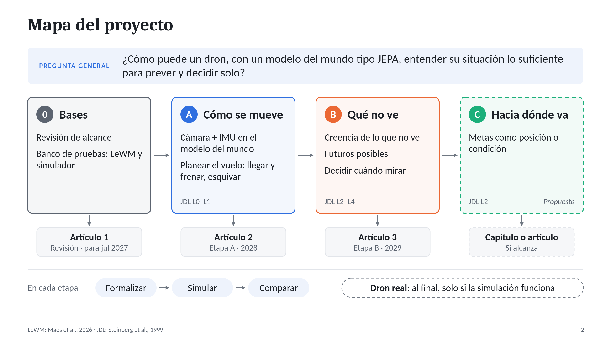
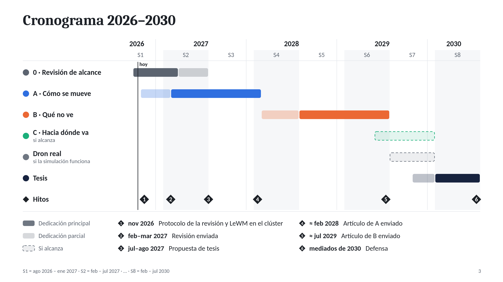
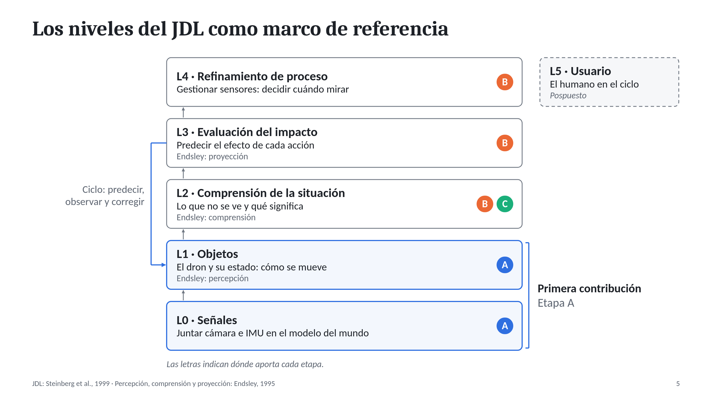
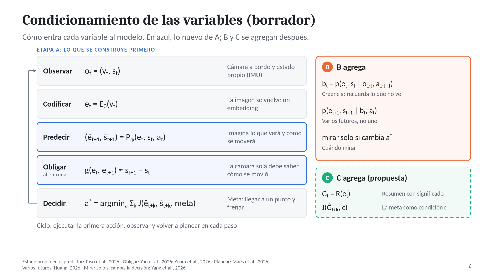

# Semantic World Modeling for Embodied Autonomous UAVs

**Tesis doctoral** · Rafael Alejandro Cruz Ovando · avance a octubre de 2026

Título propuesto, por acordar: *Self-Supervised Predictive World Models for Situation-Aware Autonomous UAVs*

## La pregunta

> ¿Cómo puede un dron construir, desde un modelo del mundo autosupervisado tipo JEPA, una representación de su situación que le permita predecir y evaluar el impacto de sus acciones para decidir solo?

Se responde en tres etapas que construyen un mismo sistema:

| Etapa | Qué resuelve | Estado |
|---|---|---|
| **A · Cómo se mueve** | Juntar la cámara a bordo con la IMU en el modelo del mundo, para que el dron sepa cómo se mueve y pueda planear su vuelo | Comprometida; primera contribución |
| **B · Qué no ve** | Llevar una creencia de lo que no ve y de los futuros posibles, y decidir cuándo conviene mirar | Comprometida |
| **C · Hacia dónde va** | Escribir la meta como posición o condición con significado, no como una foto | Propuesta, si alcanza el tiempo |

## Cronograma

Entregables: una revisión de alcance sobre modelos del mundo tipo JEPA usados para decidir (envío en feb–mar de 2027), el artículo de la etapa A (≈ feb 2028) y el de la etapa B (≈ jul 2029). La propuesta de tesis es en julio o agosto de 2027.

## Lo hecho hasta ahora

1. **Marco de referencia.** Los niveles del modelo JDL de fusión de datos y la *situation awareness* de Endsley, usados para ubicar el trabajo, no como receta.
2. **Primer modelo.** Una representación semántica de la situación sobre JEPA (niveles 2 y 3 del JDL), presentada a los asesores en octubre de 2026.
3. **Indicaciones de esa reunión.** Respaldar la representación o compararla con otras opciones, ir de lo simple a lo complejo, dejar fuera por ahora al humano (nivel 5) y preparar este mapa y cronograma.
4. **Revisión de la literatura.** Más de 100 artículos leídos, completos o en parte, y un censo en arXiv de 601 artículos sobre JEPA y 59 sobre modelos del mundo aéreos (al 20 de octubre de 2026).
5. **El hallazgo que reordenó el plan.** Para un dron, los niveles 0 y 1 no están resueltos: un solo cuadro de video no contiene la velocidad, sin el estado propio no se puede planear un sistema inestable y ningún modelo del mundo JEPA junta la cámara a bordo con la IMU para planear un vuelo. Por eso la fase 1, que se pensaba solo adaptar, se volvió la etapa A.
6. **La etapa A, definida:** problema, pregunta, hipótesis y contribución, resumidos abajo.

## La etapa A en breve

- **Problema.** Un dron es rápido e inestable, y casi todo lo que cambia en su cámara se debe a su propio movimiento. Un JEPA que aprende solo de imágenes registra mal ese movimiento. Las piezas existen por separado: un JEPA de dron que usa su estado pero no ve, drones con cámara que no usan la IMU o no planean con el modelo, y JEPA que juntan imagen y estado propio, pero con la cámara fija o en un vehículo lento y estable.
- **Pregunta.** ¿Cómo debe entrar el movimiento propio de un dron (lo que miden su IMU y su estado) en un modelo del mundo tipo JEPA que aprende de su cámara a bordo, para que el modelo sepa cómo se mueve el dron y le sirva para planear su vuelo? ¿Y en qué condiciones juntar cámara y movimiento propio planea mejor que usar solo uno de los dos, o que un modelo que no es JEPA con los mismos sensores?
- **Hipótesis.** Si el movimiento propio entra al predictor y además se obliga al latente de la cámara a seguir registrando el movimiento, el modelo planea el vuelo con más éxito que usando solo la cámara o solo el estado en tres condiciones: cuando importa la velocidad, cuando hay obstáculos que solo ve la cámara y cuando cambia la dinámica o falla un sensor.
- **Contribución.** (1) Dónde y cómo debe entrar el movimiento propio en el modelo. (2) Planear un vuelo con un JEPA de cámara e IMU, en simulación. (3) El mapa de condiciones en que pagan la cámara, la IMU y el propio JEPA.

## Qué sigue

- **Noviembre de 2026:** el protocolo de la revisión de alcance; LeWM funcionando en el clúster; escoger el simulador.
- **Febrero–marzo de 2027:** enviar la revisión.
- **Marzo–julio de 2027:** formalizar la etapa A y obtener los primeros resultados (sondas y predicción) para la propuesta de tesis.

## Artículos

- [REFERENCIAS.md](REFERENCIAS.md): los 38 artículos leídos más relevantes, por tema, con su DOI.
- Los PDF están en una carpeta de Google Drive con acceso por invitación: *enlace pendiente*.
