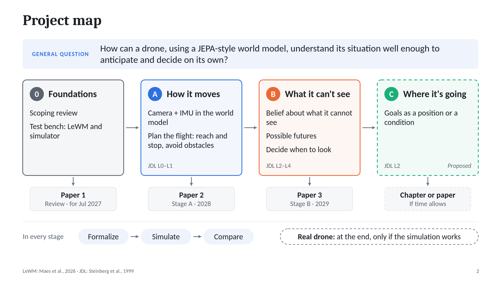
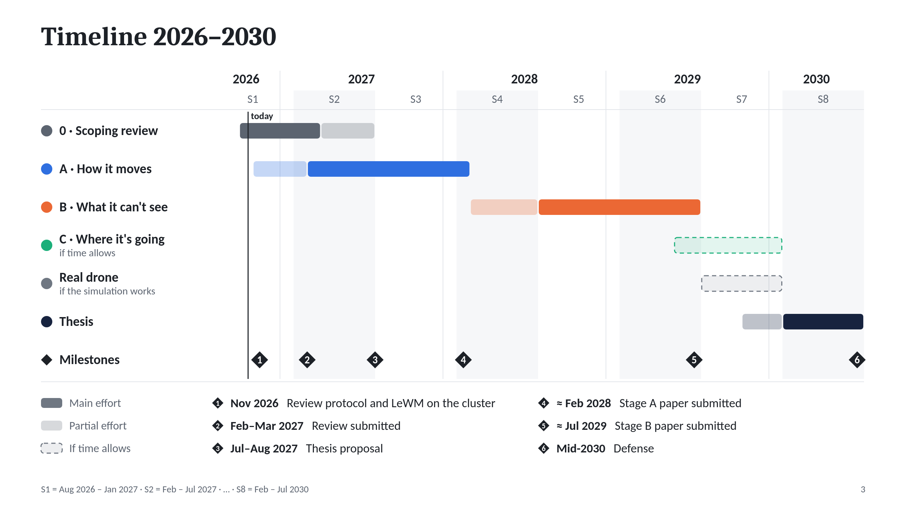
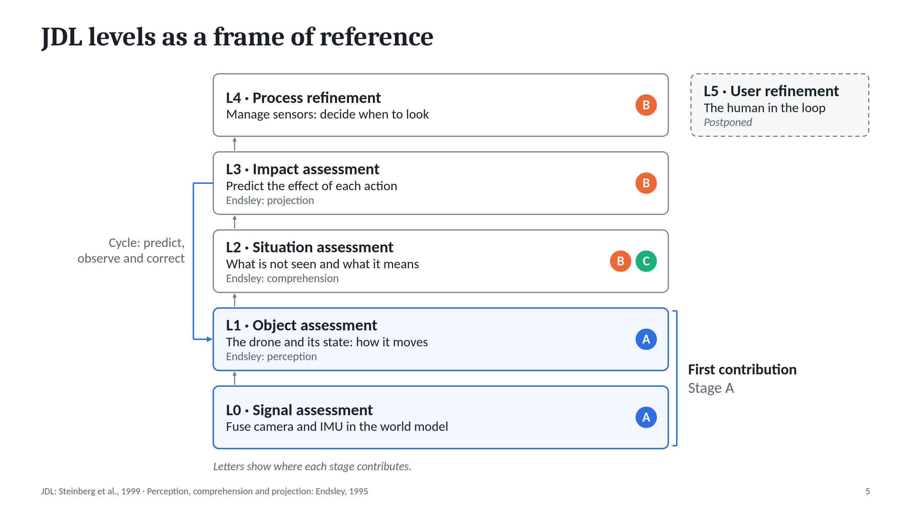
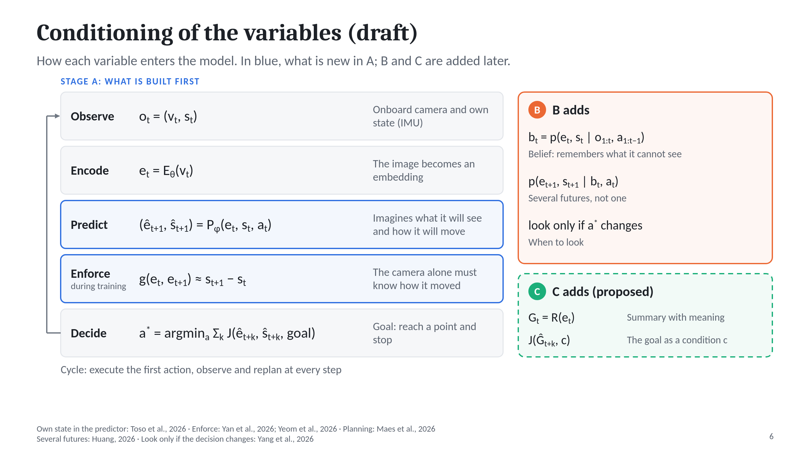

# Semantic World Modeling for Embodied Autonomous UAVs

**PhD thesis** · Rafael Alejandro Cruz Ovando · progress as of October 2026

Proposed title, to be agreed: *Self-Supervised Predictive World Models for Situation-Aware Autonomous UAVs*

## The question

> How can a drone build, from a self-supervised JEPA-style world model, a representation of its situation that lets it predict and evaluate the impact of its actions in order to decide on its own?

It is answered in three stages that build a single system:

| Stage | What it solves | Status |
|---|---|---|
| **A · How it moves** | Fuse the onboard camera with the IMU in the world model, so the drone knows how it moves and can plan its flight | Committed; first contribution |
| **B · What it can't see** | Keep a belief about what it cannot see and about the possible futures, and decide when it is worth looking | Committed |
| **C · Where it's going** | Write the goal as a position or a condition with meaning, not as a picture | Proposed, if time allows |

## Timeline

Deliverables: a scoping review of JEPA-style world models used for decision-making (submission in Feb–Mar 2027), the stage A paper (≈ Feb 2028) and the stage B paper (≈ Jul 2029). The thesis proposal is in July or August 2027.

## What has been done so far

1. **Frame of reference.** The levels of the JDL data fusion model and Endsley's *situation awareness*, used to locate the work, not as a recipe.
2. **First model.** A semantic representation of the situation on top of JEPA (JDL levels 2 and 3), presented to the advisors in October 2026.
3. **Guidance from that meeting.** Support the representation or compare it with alternatives, go from simple to complex, leave the human (level 5) out for now, and prepare this map and timeline.
4. **Literature review.** More than 100 papers read, fully or in part, and an arXiv census of 601 papers on JEPA and 59 on aerial world models (as of 20 October 2026).
5. **The finding that reordered the plan.** For a drone, JDL levels 0 and 1 are not solved: a single video frame does not contain velocity, an unstable system cannot be planned without its own state, and no JEPA world model fuses the onboard camera with the IMU to plan a flight. That is why phase 1, which was meant to be a simple adaptation, became stage A.
6. **Stage A defined:** problem, question, hypothesis and contribution, summarized below.

## Stage A in brief

- **Problem.** A drone is fast and unstable, and almost everything that changes in its camera is due to its own motion. A JEPA that learns only from images registers that motion poorly. The pieces exist separately: a drone JEPA that uses its state but does not see, camera-equipped drones that do not use the IMU or do not plan with the model, and JEPAs that combine images with the agent's own state, but with a fixed camera or on a slow, stable vehicle.
- **Question.** How should a drone's own motion (what its IMU and state measure) enter a JEPA-style world model that learns from its onboard camera, so that the model knows how the drone moves and can be used to plan its flight? And under which conditions does combining camera and own motion plan better than using only one of them, or than a non-JEPA model with the same sensors?
- **Hypothesis.** If the drone's own motion enters the predictor, and the camera latent is also forced to keep registering that motion, the model plans the flight more successfully than with the camera alone or the state alone under three conditions: when velocity matters, when there are obstacles that only the camera sees, and when the dynamics change or a sensor fails.
- **Contribution.** (1) Where and how the drone's own motion should enter the model. (2) Planning a flight with a camera-and-IMU JEPA, in simulation. (3) A map of the conditions under which the camera, the IMU and JEPA itself pay off.

## Next steps

- **November 2026:** the scoping review protocol; LeWM running on the cluster; choose the simulator.
- **February–March 2027:** submit the review.
- **March–July 2027:** formalize stage A and obtain first results (probes and prediction) for the thesis proposal.

## Papers

- [REFERENCES.md](REFERENCES.md): the 38 most relevant papers read, by topic, with DOI and a link to each PDF.
- All the PDFs: [Google Drive folder](https://drive.google.com/drive/folders/1Obm_1B9zgg5RyZssxd5ZyWDiSUHBFwrG?usp=sharing).
